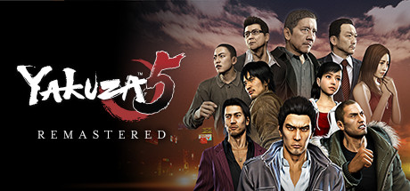

**Yakuza 5 is the most ambitious entry in the series, featuring five playable protagonists across five cities, each with unique gameplay styles including taxi driving and hunting. An enormous sprawling crime saga in the Dragon of Dojima's most epic chapter.**

---

## 📖 About

Yakuza 5 is the most ambitious entry in the series, featuring five playable protagonists across five cities, each with unique gameplay styles including taxi driving and hunting. An enormous sprawling crime saga in the Dragon of Dojima's most epic chapter.

## ⚠️ Problems Without Trainer

| Problem | Status |
|---------|--------|
| **Length** — 50+ hour main story with five distinct character arcs | ✅ Solved |
| **Mini-game Volume** — Completing all substories across five characters is an enormous undertaking | ✅ Solved |
| **Pacing Issues** — Some character story arcs are significantly slower than others | ✅ Solved |
| **Grinding for Completion** — 100% completion requires extensive minigame mastery across all cities | ✅ Solved |

## ✅ Solution

The **Yakuza 5 Trainer** solves all these issues by giving you complete control over the game.

## 🎯 Full Feature List

- Unlimited Resources
- God Mode / Invincibility
- Instant Skill Cooldown
- One-Hit Kill
- Freeze Game Timer
- Unlock All Items & Achievements
- Custom Speed Multiplier
- Save State Anywhere

## 🚀 Quick Start

1. **Disable Windows Defender** temporarily (trainer may trigger false positive)
2. Download the trainer from the button above
3. Launch Yakuza 5
4. Run the trainer as Administrator
5. Activate desired cheats with hotkeys

## 💎 Free vs Paid

| Feature | Free | Pro |
|---------|------|-----|
| Basic God Mode | ✅ | ✅ |
| Unlimited Resources | ✅ | ✅ |
| All Advanced Cheats | ❌ | ✅ |
| Auto-Updates | ❌ | ✅ |
| Priority Support | ❌ | ✅ |

## 💻 Requirements

- Windows 10/11 (64-bit)
- Yakuza 5 (any version)
- .NET Framework 4.8+
- DirectX 11+

## 🍎 macOS

macOS users can use our alternative tool:

## ⚖️ Legal

This trainer is for educational and single-player use only. Use responsibly.

---

